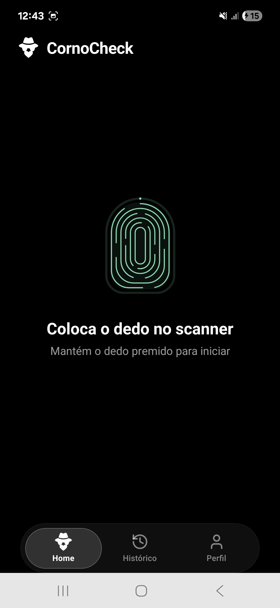
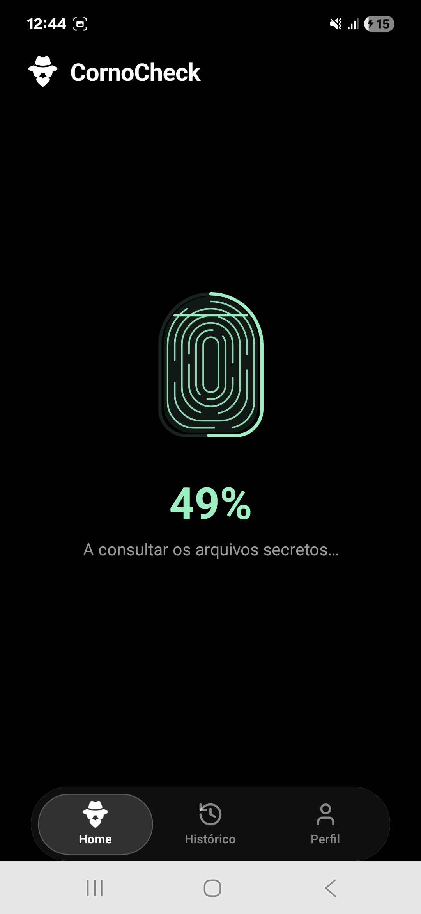

# CornoCheck — Aplicação Móvel de Entretenimento

Uma aplicação móvel de entretenimento que simula uma análise para verificar a possibilidade de infidelidade num relacionamento, utilizando uma experiência interactiva baseada na captura de uma fotografia e na apresentação de um resultado.

O CornoCheck combina animações, utilização da câmara frontal e uma interface dinâmica para proporcionar uma experiência divertida e envolvente aos utilizadores.

> **Aviso:** O CornoCheck é exclusivamente uma aplicação de entretenimento. Os resultados apresentados são fictícios e não constituem qualquer método científico ou real de detecção de infidelidade.

## 1. Problema que procura resolver

O CornoCheck não pretende resolver um problema social (INFIDELIDADE). O seu objectivo é proporcionar uma experiência de entretenimento digital, explorando a curiosidade e o humor em torno de relacionamentos.

A aplicação transforma uma brincadeira popular numa experiência móvel interactiva, permitindo que os utilizadores participem numa simulação divertida através de uma fotografia e de uma sequência de animações.

## 2. Principais funcionalidades

- **Ecrã de apresentação (Splash Screen):** introdução visual à aplicação.
- **Onboarding:** apresentação inicial da experiência e orientação do utilizador.
- **Scanner animado:** simulação de um processo de análise antes da captura da fotografia.
- **Captura de fotografia:** utilização da câmara frontal do dispositivo.
- **Apresentação de resultados:** exibição de um resultado de entretenimento após a experiência.
- **Navegação personalizada:** organização da experiência através de diferentes ecrãs e componentes de navegação.
- **Persistência local:** armazenamento de informações no dispositivo utilizando MMKV.
- **Experiência visual:** utilização de animações e elementos gráficos para tornar a aplicação mais envolvente.

## 3. Tecnologias utilizadas

| Tecnologia | Finalidade |
|---|---|
| React Native | Desenvolvimento da aplicação móvel |
| Expo SDK 57 | Ambiente e ferramentas de desenvolvimento |
| TypeScript | Tipagem estática e organização do código |
| Expo Router | Navegação e gestão de rotas |
| MMKV | Armazenamento local de dados |
| Expo Camera | Acesso à câmara do dispositivo |
| NativeWind / Tailwind CSS | Estilização da interface |

## 4. Arquitectura do sistema

O projecto segue uma organização modular baseada em funcionalidades (*feature-based architecture*), separando a navegação, os componentes reutilizáveis, as funcionalidades e os serviços auxiliares.

### Estrutura principal

```text
src/
│
├── app/
│   ├── (app)/
│   ├── onboarding/
│   ├── _layout.tsx
│   └── splash.tsx
│
├── components/
│   ├── navigation/
│   └── ui/
│
├── constants/
│   └── theme.ts
│
├── features/
│   ├── history/
│   ├── home/
│   ├── onboarding/
│   └── splash/
│
├── lib/
│   ├── hooks/
│   └── storage.tsx
│
└── global.css
```

### Responsabilidade dos principais módulos

- `app/`: gestão das rotas, navegação e composição dos ecrãs.
- `components/`: componentes reutilizáveis e elementos de navegação.
- `constants/`: configurações e constantes visuais da aplicação.
- `features/`: implementação das funcionalidades organizadas por domínio.
- `lib/`: funcionalidades auxiliares, hooks e mecanismos de armazenamento.
- `assets/`: recursos gráficos e imagens utilizados na aplicação.

### Fluxo geral da aplicação

```text
Início
  │
  ▼
Splash Screen
  │
  ▼
Onboarding
  │
  ▼
Ecrã Principal
  │
  ▼
Animação do Scanner
  │
  ▼
Captura de Fotografia
  │
  ▼
Apresentação do Resultado
  │
  ▼
Histórico / Nova Experiência
```

## 5. Capturas de ecrã e demonstração







## 6. Como instalar e executar

### Pré-requisitos

- Node.js.
- npm.
- Expo CLI / Expo.
- Android Studio ou dispositivo Android físico.
- Development Build compatível com os módulos nativos utilizados.

### Clonar o repositório

```bash
git clone https://github.com/Macuvule/corno.git
```

### Entrar na pasta do projecto

```bash
cd corno
```

### Instalar as dependências

```bash
npm install
```

### Executar a aplicação

```bash
npx expo start
```

Para executar num dispositivo Android com uma Development Build instalada, utilizar as opções de execução disponibilizadas pelo Expo.

**Nota:** Como o projecto utiliza funcionalidades nativas, como o acesso à câmara, poderá ser necessário gerar e instalar uma Development Build compatível antes da execução.
